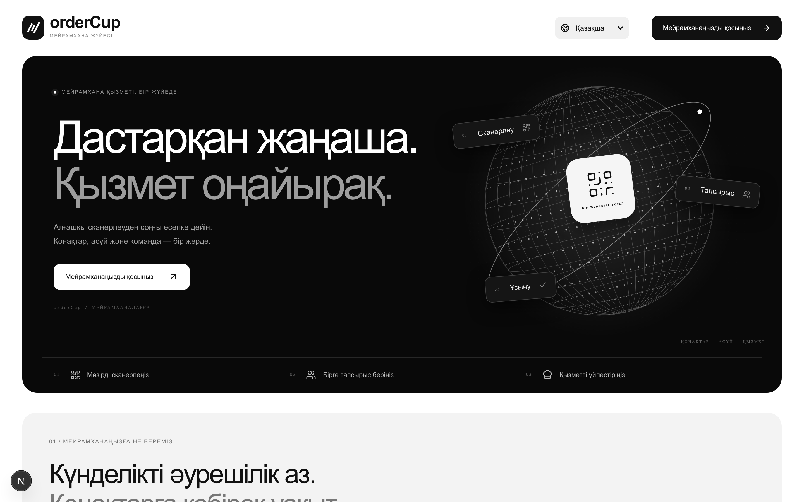
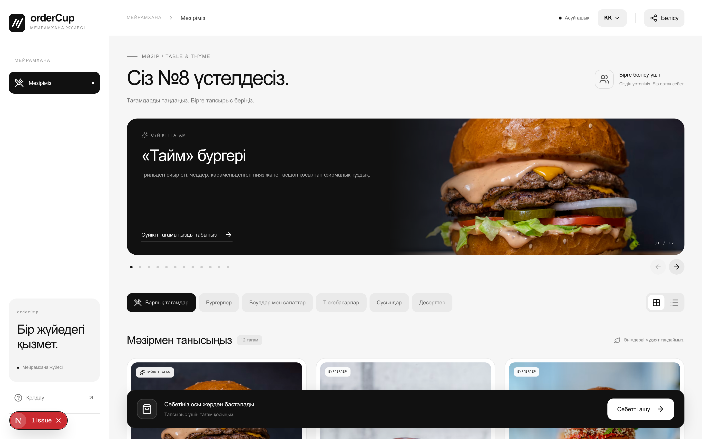
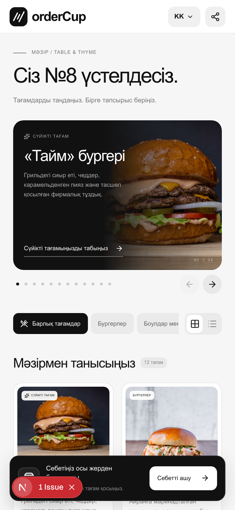
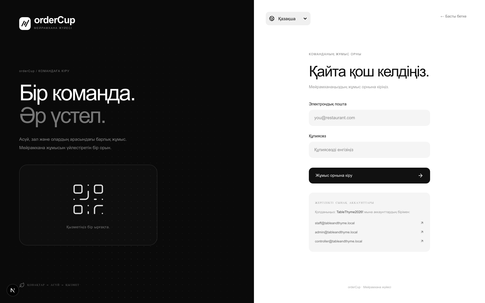
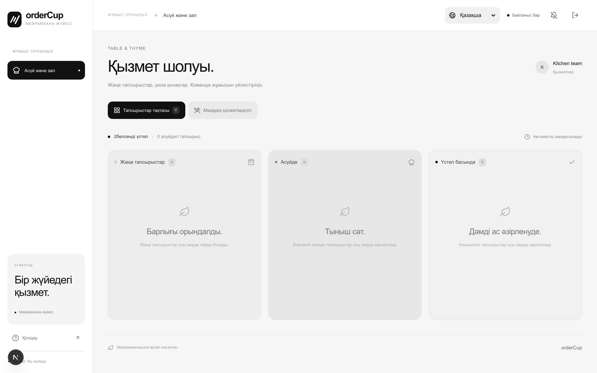
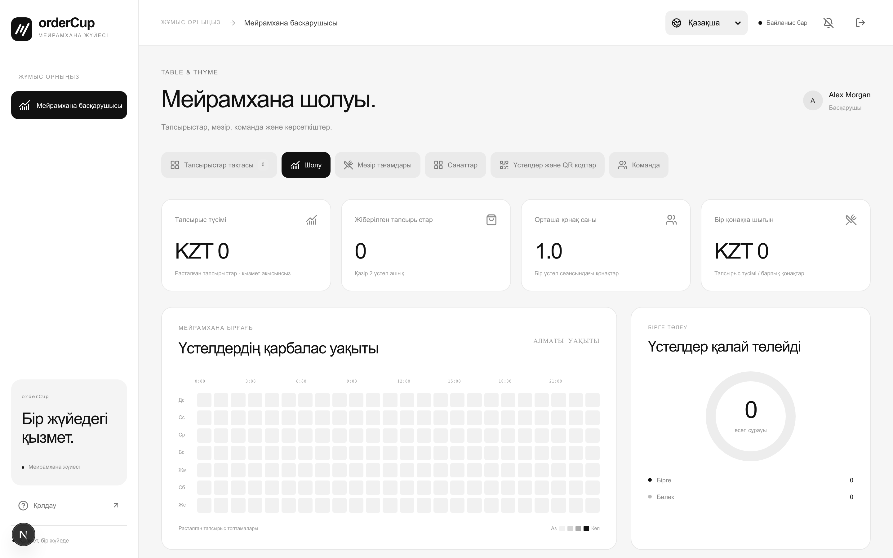

# ☕ orderCup — Collaborative Restaurant Ordering & Operations Platform

**Lead Full-Stack & Systems Developer** | `09.2026 — Present`  
Платформа для ресторанов, объединяющая совместный заказ блюд гостями за столиком, работу кухни в реальном времени и аналитическое управление заведением.

🔗 **GitHub:** [github.com/defiveninth/openCup](https://github.com/defiveninth/openCup) | 🌐 **Demo Tenant:** `Table & Thyme`

---

### 🛠 Технологии
* **Frontend & UI:** React 19, Next.js (App Router), TypeScript, Tailwind CSS v4, Radix UI Primitives, Lucide Icons, Zustand (оптимистичные обновления счетчиков)
* **Backend & База данных:** Node.js, Drizzle ORM, PostgreSQL (строгие внешние ключи, транзакционные блокировки корзины, схемы миграций)
* **Real-time & Потоки:** Server-Sent Events (SSE) с автореконнектом и heartbeat — мгновенная передача заказов на кухню без перегрузки базы
* **Безопасность & Доступ:** Signed HttpOnly cookies, scrypt-хеширование паролей, RBAC (Kitchen/Floor, Manager, Platform Controller), защита от гонок при оформлении заказов
* **Тестирование & Качество:** Playwright E2E тесты, ESLint v9, Prettier, автоматизированные проверки целостности корзин и платежей

---

### 🎯 Реализованный функционал
* **Совместный заказ за столиком (Collaborative Table Bucket):** Гости за одним столом сканируют QR-код стола и наполняют общую корзину. Каждый гость управляет своими блюдами, а хост стола утверждает и отправляет общий заказ.
* **Интерактивная доска кухни и зала (Kitchen & Floor Live Board):** Кухня и официанты получают заказы в реальном времени через SSE и переводят их по стадиям: `В ожидании` → `Готовится` → `Подано на стол`.
* **Честный расчет и разделение счета:** Гибкий запрос счета (общий или раздельный по персонам) с математически точным распределением сервисного сбора без погрешностей округления.
* **Мультитенантная панель управляющего:** Управление меню, категориями блюд, столами, генерацией динамических QR-кодов и аккаунтами персонала.
* **Аналитика и метрики:** Почасовая тепловая карта загруженности залов (Table Rush Hours), статистика популярных блюд и конверсии заказов.

---

### 💻 Интерфейс

#### 1. Главная страница (Landing Page)
Презентация платформы для ресторанных сетей и форма подключения заведений.

  

#### 2. Меню и оформление заказа гостем (Десктоп)
Каталог блюд, фильтрация по категориям и интерактивная карточка стола.

  

#### 3. Мобильный интерфейс гостя за столом №8
Адаптивный Mobile-First дизайн с корзиной, языковым переключателем и быстрым шарингом стола.

  

#### 4. Авторизация персонала и менеджеров (Admin Portal)
Единая точка входа для кухни, администраторов и владельцев платформы с разграничением прав.

  

#### 5. Интерактивная доска кухни и зала (Live Orders Board)
Управление статусами готовности блюд и подачей на стол в режиме реального времени.

  

#### 6. Панель управления и аналитика заведения (Manager Dashboard)
Выручка, средний чек, отчеты по заказам и тепловая карта загруженности столов.

  

